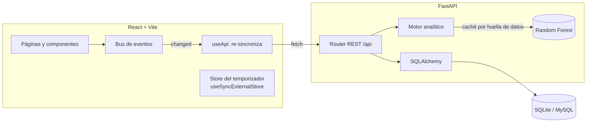

<div align="center">

# ⬡ LifeOS

**El sistema operativo de tu vida.**
Hábitos, objetivos, aprendizaje y productividad conectados por un motor de Machine Learning que descubre *qué* hace que tus días sean productivos.


</div>

---

## ✨ Qué lo hace especial

| | |
|---|---|
| 🧠 **Simulador «¿y si…?»** | Mueve un slider de sueño o activa hábitos y un Random Forest predice tu productividad **en vivo**, con intervalo de confianza calculado a partir de la dispersión de sus 200 árboles. |
| 📊 **ML honesto** | Las métricas se miden con **validación cruzada K-Fold** (R², MAE) y se comparan con una línea base. Nada de reportar el ajuste sobre los datos de entrenamiento. |
| 🔥 **Mapa de calor de 6 meses** | Estilo "contribuciones" de GitHub, con tooltip por día. |
| 🧮 **Matriz de correlación** | Pearson entre sueño, HRV, cada hábito y la productividad, interactiva. |
| 🧘 **Modo zen** | Temporizador a pantalla completa con aura que respira, **ruido marrón generado con Web Audio** y cuenta atrás en la pestaña. Sigue funcionando aunque navegues. |
| 🎮 **Gamificación** | XP por cada acción, niveles con curva cuadrática, rachas y confeti hecho a mano en `<canvas>`. |
| ⌨️ **Teclado primero** | Paleta de comandos `Ctrl K` con búsqueda difusa, creación rápida (`+ tarea`) y atajos `1–6`, `F`, `C`, `?`. |
| 🤖 **LifeOS AI** | Chat que responde con tus propios datos: patrones, consejos, proyección de mañana, precisión del modelo. |
| ✅ **Check-in diario** | Registra sueño y productividad; el modelo se reentrena solo cuando cambian los datos. |

## 🏗️ Arquitectura



**Decisiones de diseño**

- **Caché del modelo por huella de datos.** Entrenar el bosque + validación cruzada cuesta ~1.5 s. Se calcula una huella barata (conteos y sumas de las tablas) y solo se reentrena cuando cambia → las peticiones siguientes responden en ~5 ms.
- **Re-sincronización por eventos.** Toda escritura (`POST/PATCH/DELETE`) emite un evento; cada `useApi` montado se recarga solo. La sidebar, el dashboard y las páginas siempre muestran el mismo estado sin prop-drilling ni librerías de estado.
- **Temporizador basado en marcas de tiempo**, no en contar *ticks*: es exacto aunque el navegador congele la pestaña.
- **Datos sintéticos con relaciones reales.** El *seed* genera 180 días donde meditar, hacer ejercicio, programar y dormir bien influyen en la productividad. Los tests comprueban que el modelo **recupera** esas relaciones.

## 🚀 Arranque rápido

- **Windows:** doble clic en `start.bat`
- **Mac/Linux:** `./start.sh`

Luego abre **http://localhost:5180** — la documentación interactiva de la API está en **http://localhost:8010/docs**.

### Arranque manual

```bash
# Terminal 1 — API
cd backend
cp .env.example .env          # deja DB_HOST vacío para usar SQLite
python -m venv .venv
.venv\Scripts\activate        # Mac/Linux: source .venv/bin/activate
pip install -r requirements.txt
uvicorn app.main:app --reload --port 8010

# Terminal 2 — Interfaz
cd frontend
npm install
npm run dev
```

La base de datos se crea sola con 6 meses de datos de ejemplo. Para reiniciarla: paleta de comandos → *Restablecer datos de demostración*.

### Tests

```bash
cd backend
pip install -r requirements-dev.txt
pytest -q
```

## 🔌 API

| Método | Ruta | Descripción |
|---|---|---|
| `GET` | `/api/dashboard` | Resumen del día, rachas, sparklines, nivel |
| `GET` | `/api/insights` | Lifts, correlaciones, importancia, métricas CV, tendencia |
| `POST` | `/api/simulate` | Predicción para un escenario hipotético (+ IC 80 %) |
| `GET/POST` | `/api/checkin` | Check-in diario de sueño y productividad |
| `GET` | `/api/heatmap?days=182` | Serie diaria para el mapa de calor |
| `POST` | `/api/habits/{id}/toggle` | Marca o desmarca un hábito en una fecha |
| `CRUD` | `/api/goals` · `/api/learning` · `/api/tasks` | Gestión de entidades |
| `POST` | `/api/chat` | Asistente con intents sobre tus datos |
| `GET` | `/api/export` | Exporta todos tus datos en JSON |

## ⌨️ Atajos

| Tecla | Acción |
|---|---|
| `Ctrl K` | Paleta de comandos (`+ texto` crea una tarea) |
| `1`–`6` | Cambiar de sección |
| `F` | Iniciar sesión de enfoque en modo zen |
| `C` | Abrir el chat |
| `?` | Ver todos los atajos |

## 🧰 Stack

**Backend:** Python · FastAPI · SQLAlchemy 2 · Pydantic 2 · Pandas · NumPy · scikit-learn · pytest
**Frontend:** React 18 · Vite · Tailwind CSS · Framer Motion · Recharts · Web Audio API · Canvas 2D
