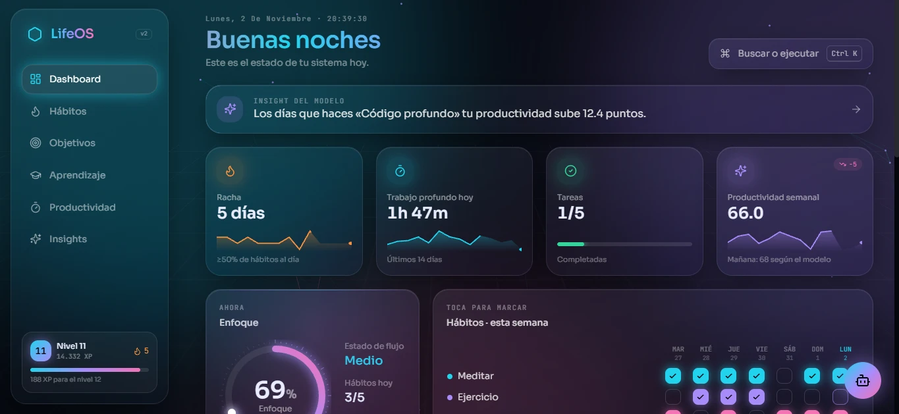
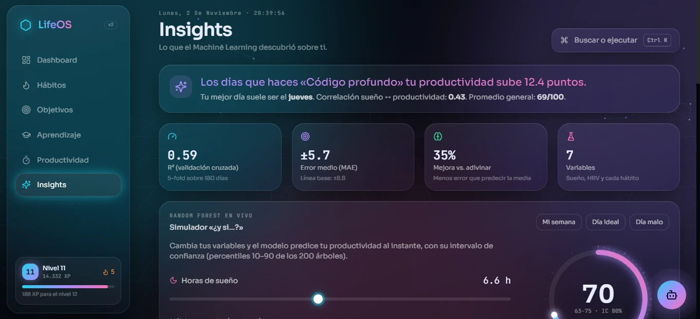
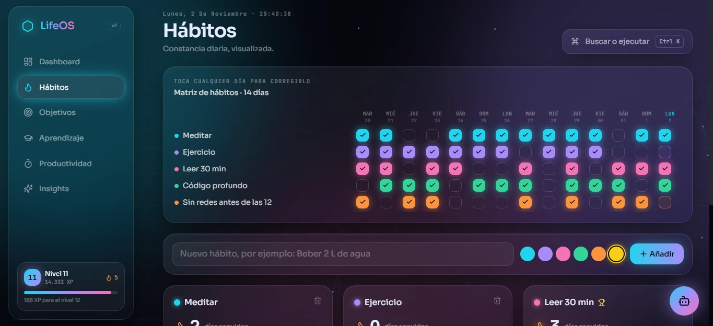
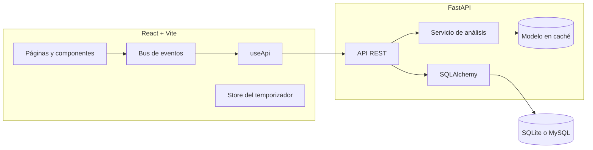

# LifeOS

Aplicación web para registrar hábitos, objetivos, aprendizaje y sesiones de trabajo, con un modelo de Machine Learning que analiza el historial y estima qué factores influyen en la productividad diaria.

[](https://github.com/saracastrillons/lifeos/actions/workflows/ci.yml)



## Descripción

La mayoría de las apps de hábitos se limitan a contar rachas. LifeOS parte de una pregunta distinta: de todo lo que hago en un día, ¿qué es lo que realmente se relaciona con un buen rendimiento?

Para responderla, el backend cruza los hábitos registrados con métricas diarias (horas de sueño, variabilidad cardíaca y una puntuación de productividad) y entrena un Random Forest sobre ese historial. El resultado se presenta en la interfaz como efectos medibles por hábito, correlaciones entre variables y un simulador que predice la productividad de un día hipotético.

El proyecto está construido con FastAPI y scikit-learn en el backend, y React en el frontend.

## Funcionalidades

**Análisis**

- Simulador de escenarios: al ajustar las horas de sueño o activar y desactivar hábitos, el modelo devuelve una predicción en tiempo real con un intervalo del 80 % calculado a partir de la dispersión de los árboles del bosque.
- Efecto de cada hábito en puntos de productividad (diferencia de medias entre días con y sin el hábito).
- Matriz de correlación de Pearson entre todas las variables.
- Importancia de variables del modelo, tendencia con media móvil de 7 días y análisis por día de la semana.
- Asistente conversacional que responde preguntas sobre los propios datos: patrones, mejor día, proyección para mañana o precisión del modelo.

**Seguimiento**

- Matriz de hábitos editable por día, rachas y porcentaje de cumplimiento.
- Mapa de calor de los últimos seis meses.
- Check-in diario de sueño y productividad, que alimenta el modelo con datos nuevos.
- Objetivos con fecha límite y progreso, y registro de horas de estudio por tema.
- Temporizador de enfoque (25, 50 o 90 minutos) con modo de pantalla completa y ruido marrón generado con la Web Audio API.

**Interfaz**

- Paleta de comandos (`Ctrl K`) con búsqueda aproximada y creación rápida de tareas.
- Navegación completa por teclado.
- Sistema de niveles y experiencia basado en la actividad registrada.
- Diseño adaptable a móvil.

<table>
  <tr>
    <td></td>
    <td></td>
  </tr>
  <tr>
    <td align="center">Insights y simulador</td>
    <td align="center">Matriz de hábitos</td>
  </tr>
</table>

## El modelo

Cada día del historial es una fila. Las variables de entrada son las horas de sueño, la variabilidad cardíaca (HRV) y una columna binaria por cada hábito; la variable objetivo es la puntuación de productividad de ese día.

Se usa un `RandomForestRegressor` (200 árboles, `min_samples_leaf=3`). La evaluación se hace con validación cruzada de 5 particiones, de modo que las métricas reflejan el error sobre días que el modelo no vio durante el entrenamiento:

| Métrica | Valor |
|---|---|
| R² (validación cruzada) | 0.59 |
| Error absoluto medio | 5.7 puntos |
| Error de la línea base (predecir siempre la media) | 8.8 puntos |
| Reducción del error frente a la línea base | 35 % |

Algunas consideraciones:

- Los datos de demostración son sintéticos. El script `seed.py` genera 180 días en los que ciertos hábitos tienen un efecto real sobre la productividad, y los tests comprueban que el modelo recupera esas relaciones. Con datos reales el rendimiento dependerá del volumen y la calidad del registro.
- El análisis muestra asociaciones, no causalidad. Que un hábito coincida con días productivos no implica que los provoque.
- Se requieren al menos 10 días registrados para entrenar el modelo.

## Arquitectura



Decisiones técnicas relevantes:

- **Caché del modelo.** Entrenar el bosque y ejecutar la validación cruzada tarda alrededor de 1.5 segundos. En lugar de hacerlo en cada petición, el servicio calcula una huella de los datos (conteos y sumas de las tablas implicadas) y solo reentrena cuando esta cambia. Las peticiones posteriores responden en unos 5 ms.
- **Sincronización del estado en el cliente.** Cada operación de escritura emite un evento interno; los componentes que consumen datos de la API se suscriben a él y se recargan. Así la barra lateral, el dashboard y el resto de vistas se mantienen consistentes sin una librería de estado global.
- **Temporizador independiente de la vista.** El estado del temporizador vive en un store externo (`useSyncExternalStore`) y se calcula a partir de marcas de tiempo, por lo que sigue siendo preciso al cambiar de sección o si el navegador suspende la pestaña.
- **Validación en el borde.** Todos los cuerpos de petición se validan con Pydantic (rangos, longitudes y valores permitidos) antes de llegar a la base de datos.
- **Base de datos configurable.** Por defecto usa SQLite; definiendo las variables de `.env` se conecta a MySQL sin cambios en el código.

## Estructura del proyecto

```
LifeOS/
├── backend/
│   ├── app/
│   │   ├── main.py              # Aplicación FastAPI y ciclo de vida
│   │   ├── models.py            # Modelos SQLAlchemy
│   │   ├── schemas.py           # Validación con Pydantic
│   │   ├── routers/api.py       # Endpoints REST
│   │   └── services/analytics.py  # Pandas, scikit-learn y asistente
│   ├── tests/                   # Pruebas de la API y del modelo
│   └── seed.py                  # Generador de datos de demostración
├── frontend/
│   └── src/
│       ├── pages/               # Vistas principales
│       ├── components/          # Componentes reutilizables
│       ├── hooks/               # Acceso a datos
│       └── lib/                 # Eventos, temporizador y audio
└── .github/workflows/ci.yml     # Integración continua
```

## Ejecución local

Requisitos: Python 3.11 o superior y Node.js 18 o superior.

En Windows basta con ejecutar `start.bat`; en macOS o Linux, `./start.sh`. Ambos scripts crean el entorno virtual, instalan las dependencias y levantan los dos servidores.

Para hacerlo manualmente:

```bash
# Backend
cd backend
python -m venv .venv
.venv\Scripts\activate          # macOS/Linux: source .venv/bin/activate
pip install -r requirements.txt
uvicorn app.main:app --reload --port 8010
```

```bash
# Frontend
cd frontend
npm install
npm run dev
```

La aplicación queda disponible en `http://localhost:5180` y la documentación interactiva de la API en `http://localhost:8010/docs`. La base de datos se crea automáticamente con datos de demostración; se puede restablecer desde la paleta de comandos.

### Pruebas

```bash
cd backend
pip install -r requirements-dev.txt
pytest
```

Las pruebas cubren los endpoints principales, la validación de entradas y el comportamiento del modelo: que supere a la línea base, que identifique los hábitos con mayor efecto y que el simulador responda en la dirección esperada. Se ejecutan en cada push mediante GitHub Actions, junto con la compilación del frontend.

## API

| Método | Ruta | Descripción |
|---|---|---|
| GET | `/api/dashboard` | Resumen del día: enfoque, rachas, tareas y métricas recientes |
| GET | `/api/insights` | Efectos por hábito, correlaciones, importancia y métricas del modelo |
| POST | `/api/simulate` | Predicción para un escenario hipotético |
| GET, POST | `/api/checkin` | Consulta o registra el check-in del día |
| GET | `/api/heatmap` | Serie diaria para el mapa de calor |
| GET, POST, DELETE | `/api/habits` | Gestión de hábitos |
| POST | `/api/habits/{id}/toggle` | Marca o desmarca un hábito en una fecha |
| GET, POST, PATCH, DELETE | `/api/goals`, `/api/learning`, `/api/tasks` | Gestión de objetivos, aprendizaje y tareas |
| POST | `/api/focus` | Registra una sesión de enfoque |
| POST | `/api/chat` | Consulta al asistente |
| GET | `/api/export` | Exporta todos los datos en JSON |

## Tecnologías

Backend: Python, FastAPI, SQLAlchemy, Pydantic, Pandas, NumPy, scikit-learn, pytest.

Frontend: React, Vite, Tailwind CSS, Framer Motion, Recharts.

## Próximos pasos

- Autenticación y soporte para varios usuarios.
- Migraciones de base de datos con Alembic.
- Importación de datos de sueño y HRV desde dispositivos wearables.
- Despliegue público de una versión de demostración.

## Autora

Desarrollado por [saracastrillons](https://github.com/saracastrillons), estudiante de Ingeniería de Sistemas.
